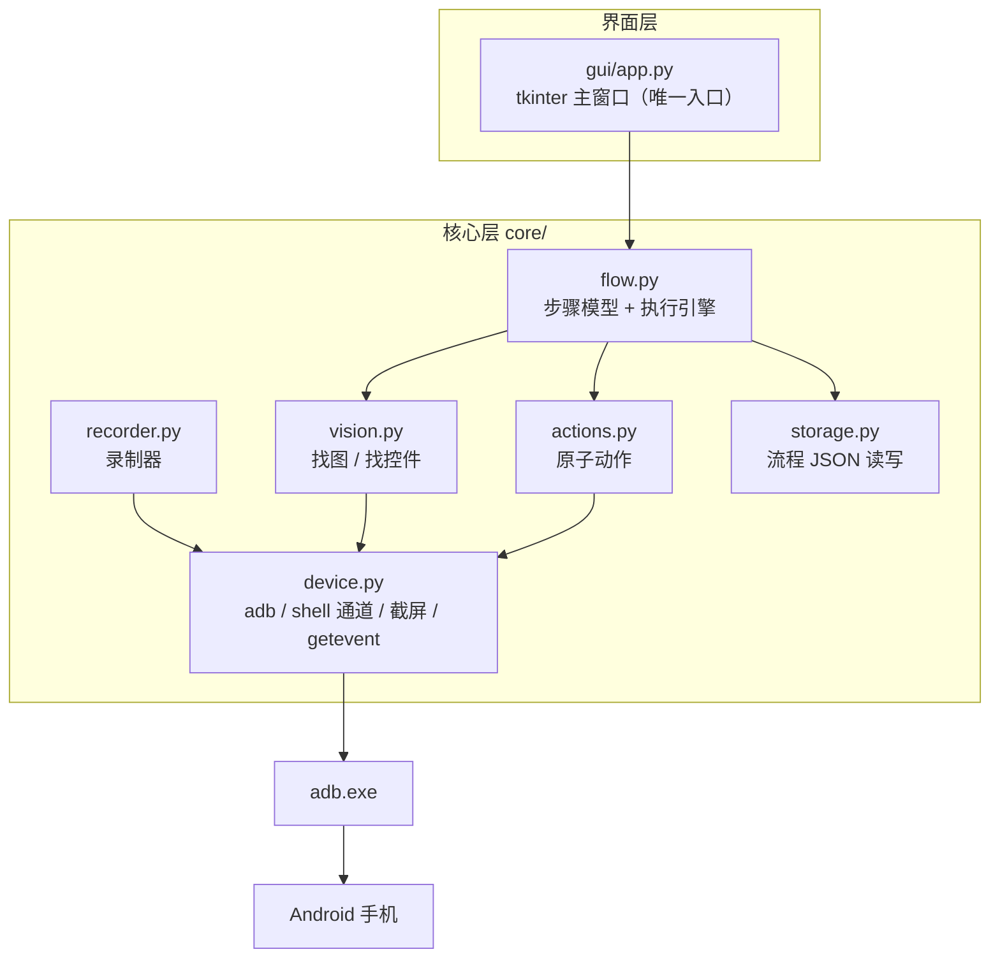
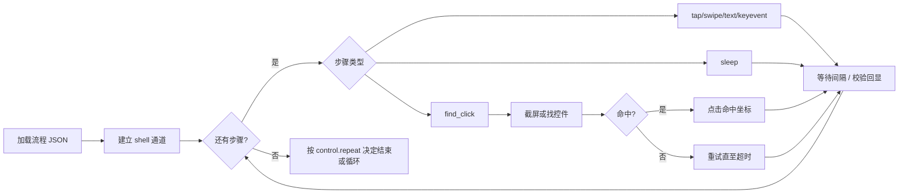
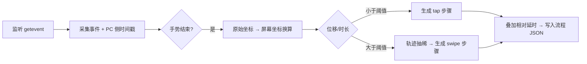

# AutoClick 二期扩展设计方案

> 状态：**已确认**（决策点见第九章，确认日期 2026-10-14）
> 日期：2026-10-14
> 一期成果：`autoclick.py`（CLI 固定坐标高频连点 + `--pick` 坐标拾取），已实机验证
> 二期起：CLI 入口**移除**，全部能力并入 GUI；最终产物为**免环境独立 EXE**

---

## 一、需求与目标

在一期能力基础上新增四类能力（一期 CLI 入口将移除，统一由 GUI 承载）：

| 编号 | 需求 | 说明 |
|---|---|---|
| R1 | GUI 控制界面 | 图形化操作连点、流程、录制、找图，替代手敲命令 |
| R2 | 录制回放 | 在手机上操作一遍，自动生成脚本并可回放 |
| R3 | 多点流程 | 多步骤编排（点击/滑动/延时/输入等），可循环、可保存复用 |
| R4 | 找图点击 | 识别屏幕上的图片/控件并自动点击，适配位置变化 |

**目标**：从「单点连点工具」升级为「可编排的安卓自动化工具」，且保持零/低依赖、无需 root、无需装机。

---

## 二、现状盘点（可复用的资产）

| 资产 | 位置 | 二期复用方式 |
|---|---|---|
| 持久 shell 通道 + 回显标记同步（24ms/次） | [autoclick.py](file:///e:/Code/AutoClick/autoclick.py) `ShellChannel` | 抽到 `core/device.py`，作为所有动作的执行底座 |
| 设备/adb 自动探测、分辨率查询 | 同上 `find_adb / list_devices / get_screen_size` | 同上 |
| `getevent` 触摸流解析 + 原始→屏幕坐标换算 | 同上 `pick_coordinates` | 抽到 `core/device.py` 的 `TouchStream`，供录制器复用 |
| 坐标拾取模式 | `--pick` | 保留，并成为 GUI 的「拾取坐标」按钮 |

已知实测参数（vivo X100s / Android 16 / 1080x2400）：触摸节点 `/dev/input/event6`，原始范围 `12599 x 27999`（比例 11.6667）。

---

## 三、总体架构



分层原则：**界面层不含业务逻辑**；核心层不含任何 UI 代码。二期仅保留 GUI 一个入口，核心层为其独占，避免逻辑散落在界面代码中。

---

## 四、模块与接口设计

### 4.1 `core/device.py`（设备层）

| 接口 | 说明 |
|---|---|
| `find_adb()` / `list_devices()` / `resolve_serial()` | 沿用一期实现 |
| `get_screen_size(serial)` | 沿用；新增缓存 |
| `class ShellChannel` | 沿用；作为注入动作的唯一通道 |
| `class TouchStream` | 新增：把 `--pick` 的事件解析抽成可复用类，回调式吐出 `(x, y, phase, timestamp)` |
| `screencap_png(serial)` | 新增：`adb exec-out screencap -p`，返回 PNG 字节流 |

要点：
- 截屏走 `exec-out`（不经过 shell 文本模式），避免 Windows 换行损坏 PNG。
- 截屏与点击**使用两条独立通道**，避免互相阻塞。

### 4.2 `core/actions.py`（原子动作层）

| 动作 | 手机端命令 |
|---|---|
| `tap(x, y)` | `input tap x y` |
| `long_press(x, y, ms)` | `input swipe x y x y ms` |
| `swipe(x1, y1, x2, y2, ms)` | `input swipe x1 y1 x2 y2 ms` |
| `text(value)` | `input text '<转义后的值>'` |
| `keyevent(key)` | `input keyevent KEYNAME` |
| `start_app(pkg/component)` | `am start -n ...` |
| `sleep(sec)` | PC 侧等待（不占用手机） |

所有动作经由 `ShellChannel` 执行并等待回显标记，保证「执行完才算一步结束」。

### 4.3 `core/flow.py`（流程层）

**步骤数据模型**（JSON，存于 `flows/*.json`）：

```json
{
  "name": "签到示例",
  "screen": {"width": 1080, "height": 2400},
  "steps": [
    {"type": "tap",   "x": 540, "y": 2000, "interval": 0.5, "count": 3},
    {"type": "swipe", "from": [540, 1800], "to": [540, 600], "duration": 300},
    {"type": "sleep", "seconds": 1.0},
    {"type": "text",  "value": "hello"},
    {"type": "find_click", "mode": "image", "target": "templates/btn.png",
     "threshold": 0.85, "timeout": 5.0, "on_miss": "skip"}
  ],
  "control": {"repeat": 1, "stop_on_error": true}
}
```

**支持的步骤类型**：`tap / long_press / swipe / sleep / text / keyevent / start_app / find_click / loop`

**执行引擎特性**：
- 顺序执行；`loop` 支持「次数」或「时长」两种终止条件
- 每步带 `timeout` 与 `retry`；失败时按 `stop_on_error` 决定中断或跳过
- 运行在**后台线程**，通过 `queue.Queue` 向 GUI 推送日志与进度，随时可「停止」
- 停止语义与一期一致：停止后不残留排队点击



### 4.4 `core/recorder.py`（录制器）

基于 `TouchStream` 采集**真实手指触摸**（一期已验证该数据流可用；程序注入的点击不会出现在其中，因此录制天然只记录人的操作）。



关键规则：
- **相对延时**：相邻手势的时间差作为前一步的 `interval`/`sleep`
- **拖动识别**：位移 > 阈值（默认 20px）判为 swipe；用 Douglas-Peucker 抽稀轨迹，保留 2~4 个关键点
- **多指**：一期仅支持单指；多指列为后续可选
- 录制演示与「一键转流程」：录完直接得到可编辑的步骤列表

### 4.5 `core/vision.py`（识别层）

提供两种定位方式，**可切换、可自动降级**：

| 方式 | 实现 | 依赖 | 适用 |
|---|---|---|---|
| A. 找控件（默认） | `uiautomator dump` → 解析 XML 的 `bounds`，按 `text`/`resource-id` 定位 | **零依赖** | 标准控件、按钮、输入框 |
| B. 找图 | 截屏 + 模板匹配 | 需 `opencv-python` + `numpy`（约 60~90MB） | 游戏画面、非控件图片、位置漂移 |

设计取舍：
- 纯标准库做全屏模板匹配性能不可接受（1080×2400 搜索空间），因此**方式 B 必须引入 OpenCV 或不提供**。
- 默认走**方式 A（零依赖）**；方式 B 需 `opencv-python` + `numpy`。**源码运行**时按需 `pip install` 后启用；**EXE 版**因目标机无法安装依赖，必须把 OpenCV 一并打包进 EXE（见 4.7）。`vision.py` 内做 `import` 探测，缺失时提示改用方式 A，而非崩溃。
- 命中后统一返回屏幕坐标，交给 `actions.tap` 执行。

### 4.6 `gui/app.py`（界面层）

技术选型：**tkinter/ttk（Python 标准库）**
理由：零安装、体积小、可被 PyInstaller 直接打包（tcl/tk 运行时可自动收集），延续项目「低依赖」基调。

界面分区：

```
┌───────────────────────────────────────────────────────┐
│ [设备] adb路径 / 设备下拉 / 分辨率 / [连接] [检查]        │
├──────────────┬────────────────────────────────────────┤
│ 左：步骤列表  │ 右：步骤参数编辑区                       │
│ · tap 540,2000│  类型: tap                              │
│ · swipe ...   │  X: 540   Y: 2000  间隔: 0.5  次数: 3   │
│ · sleep 1.0   │  [拾取坐标(手机点一下)] [上移] [下移] [删除]│
│ · find_click  │                                        │
│ [+ 添加步骤]  │  [找图配置: 模板/阈值/超时]              │
├──────────────┴────────────────────────────────────────┤
│ [开始] [停止] [录制开始/停止] [保存流程] [加载流程]        │
├───────────────────────────────────────────────────────┤
│ 日志区（滚动，带时间戳）                                 │
└───────────────────────────────────────────────────────┘
```

工程要点：
- tkinter **非线程安全**：执行引擎在后台线程，UI 用 `root.after(100, poll_queue)` 轮询队列刷新，禁止跨线程直接操作控件。
- 「拾取坐标」复用 `--pick` 逻辑：点按钮后提示「请在手机上点击目标」，捕获到坐标自动回填当前步骤。
- 关闭窗口时确保后台线程与 shell 通道被正确释放。

### 4.7 打包与运行环境（免环境独立 EXE）

**目标**：产出一个**双击即可运行、目标机器无需安装 Python 与任何依赖**的 `AutoClick.exe`。

打包方式：PyInstaller `--onefile --windowed`（隐藏控制台）。

必须一并打入 EXE 的三类内容：

| 内容 | 为什么必须内置 | 打包方式 |
|---|---|---|
| Python 运行时 + tkinter / tcl / tk | 目标机没有 Python | PyInstaller 自动收集 |
| `opencv-python` + `numpy` | 目标机装不上依赖，而「找图」必须可用 | PyInstaller 自动收集（体积 +约 60~90MB） |
| `adb.exe` + `AdbWinApi.dll` + `AdbWinUsbApi.dll` | 目标机可能没有 Android SDK；**没有 adb 整个工具完全不可用** | 作为 data 打入，运行时释放到临时目录 |

关键实现点：
- 资源定位必须走 `sys._MEIPASS`：打包后 `__file__` 指向临时解包目录，写死源码相对路径会失效。`core/device.py` 的 `find_adb()` 探测顺序调整为：① EXE 内置 adb ② 环境变量 ③ 常见 SDK 路径 ④ PATH。
- **用户数据不打包**：`flows/`（流程 JSON）与 `templates/`（找图模板）放在 **EXE 同级目录**，首次运行自动创建，保证可写、可备份、升级 EXE 不丢数据。
- 预期产物：单文件约 100~150MB，首次启动有解包延迟（数秒）。

体积取舍：可提供两个构建产物——「轻量版」（不含 OpenCV，仅找控件，约 20MB）与「完整版」（含 OpenCV，支持找图）。默认交付**完整版**。

---

## 五、目录结构（二期完成后）

```
e:\Code\AutoClick\
├── README.md                    # 项目主文档
├── main.py                      # GUI 入口（唯一入口）
├── build.spec                   # PyInstaller 打包配置
├── build.ps1                    # 打包脚本（轻量版 / 完整版）
├── resources\adb\               # 打包内置的 adb 三件套
│   ├── adb.exe
│   ├── AdbWinApi.dll
│   └── AdbWinUsbApi.dll
├── core/
│   ├── __init__.py
│   ├── device.py                # adb / ShellChannel / TouchStream / 截屏 / 资源定位
│   ├── actions.py               # 原子动作
│   ├── flow.py                  # 步骤模型 + 执行引擎
│   ├── recorder.py              # 录制器
│   ├── vision.py                # 找控件 / 找图
│   └── storage.py               # 流程 JSON 读写
├── gui/
│   └── app.py                   # tkinter 界面
├── flows/                       # 用户流程文件（*.json，运行时在 EXE 同级创建）
├── templates/                   # 找图模板图片（*.png，运行时在 EXE 同级创建）
└── docs/二期扩展/
    └── DESIGN_二期扩展.md        # 本文档
```

> 原 `autoclick.py`（一期 CLI 入口）二期**移除**，其 `ShellChannel`、设备探测与坐标拾取逻辑迁入 `core/`。

---

## 六、里程碑与任务拆解

| 里程碑 | 内容 | 交付物 | 验收要点 |
|---|---|---|---|
| M6 | 核心层抽取（并移除 CLI） | `core/device.py`、`core/actions.py` | 把 `autoclick.py` 的 ShellChannel / 设备探测 / 坐标拾取迁入 core，随后删除 `autoclick.py`；用临时自测脚本回归，确认连点频率与坐标拾取达一期水平 |
| M7 | GUI 骨架 | `main.py`、`gui/app.py` | 能连接设备、单点连点、修改间隔、实时日志、可停止 |
| M8 | 多点流程 | `core/flow.py`、`core/storage.py` | 可增删改步骤、保存/加载 JSON、执行与停止正确 |
| M9 | 录制回放 | `core/recorder.py` | 手机上操作可生成步骤；回放与手动操作效果一致 |
| M10 | 找控件点击 | `core/vision.py`（方式 A） | 零依赖下能按文本/ID 定位并点击 |
| M11 | 找图点击 | `core/vision.py`（方式 B） | 装好 OpenCV 后能按模板命中并点击 |
| M12 | 打包为免环境独立 EXE + 文档 | `AutoClick.exe`、`build.spec`、`build.ps1` | 在**未安装 Python 的 Windows 机器**上双击可运行，能完成连点、流程、录制、找控件与找图点击 |

建议实施顺序：M6 → M7 → M8 → M9 → M10 → M11 → M12（每一步独立可验证，避免一次性大重构）。

---

## 七、风险与对策

| 风险 | 影响 | 对策 |
|---|---|---|
| OpenCV 依赖体积大、安装易失败 | 方式 B 不可用 | 默认零依赖走方式 A；方式 B 做可选探测，未装则明确提示 |
| 截屏耗时（约 0.3~0.8s/次）拉低节奏 | 找图步骤频率低 | 找图步骤单独限速；缩小搜索区域（可指定 ROI） |
| tkinter 线程不安全 | 界面卡死/崩溃 | 后台线程 + 队列 + `after` 轮询，禁止跨线程操作控件 |
| 录制多指/复杂手势丢失 | 回放不还原 | 一期只支持单指；复杂场景保留「原始轨迹回放」作为兜底 |
| CLI 移除后一期能力退化 | 用户失去已验证的连点与坐标拾取能力 | M6 迁移后先用临时自测脚本回归（连点频率、坐标拾取精度），达标后再删 `autoclick.py` |
| 目标机没有 adb | 工具完全不可用 | adb 三件套打入 EXE，运行时释放，并按 `sys._MEIPASS` 定位 |
| 打包后资源路径失效 | 找不到 adb / flows / templates | 统一走 `sys._MEIPASS` 定位内置资源；用户数据目录取 EXE 同级路径 |
| 含 OpenCV 的 EXE 体积大、首启慢 | 分发与体验 | 提供轻量版与完整版两个构建；必要时 `--onefile` 改 `--onedir` |
| 中文路径/编码 | 模板路径与日志乱码 | 统一 UTF-8 处理（沿用一期经验） |
| 流程在他人设备跑 | 坐标失效 | 流程文件记录 `screen` 尺寸，加载时校验并提示按比例换算 |

---

## 八、二期验收标准（草案）

1. GUI 双击可启动，能自动发现并连接设备，显示分辨率。
2. GUI 可完成一期全部能力：单点连点、间隔/次数/时长设置、坐标拾取、随时停止（且 `autoclick.py` 已移除）。
3. 能创建 ≥5 个步骤的流程（含 tap/swipe/sleep/text），保存为 JSON 并可重新加载执行。
4. 录制模式：在手机上完成「点击 → 滑动 → 再点击」，能生成对应步骤并正确回放。
5. 找控件点击：按文本/ID 定位并点击成功。
6. 执行期间界面不卡死，日志实时刷新，停止后手机端无残留注入。
7. 坐标越界、设备掉线、模板文件缺失等异常均有中文提示。
8. 打包产物 `AutoClick.exe` 在**未安装 Python 的 Windows 机器**上双击可运行，无需任何环境配置即可连接设备并完成连点与流程执行。

---

## 九、决策点（已确认）

| 编号 | 决策点 | 结论 | 对设计的影响 |
|---|---|---|---|
| Q1 | GUI 技术栈 | **tkinter / ttk（标准库）** | 零依赖，可被 PyInstaller 直接打包 |
| Q2 | 找图实现 | **找控件为主（零依赖）+ 找图可选** | 源码运行时 OpenCV 可按需安装；**EXE 版必须内置 OpenCV**，否则目标机装不上 |
| Q3 | 录制范围 | **仅单指（点击/滑动）** | 多指（双指缩放）列入后续 |
| Q4 | 一期 CLI | **移除** | `autoclick.py` 二期删除，逻辑并入 `core/`；GUI 成为唯一入口 |
| Q5 | 打包 EXE | **需要，且须在无 Python 环境的机器上运行** | 采用 PyInstaller `--onefile --windowed`，内置 Python 运行时、tkinter、OpenCV、adb 三件套（详见 4.7） |
| Q6 | 流程文件格式 | **JSON** | 无需额外依赖 |

确认日期：2026-10-14。后续按 M6 → M12 顺序实施，每个里程碑完成后更新 README 的进度跟踪。
